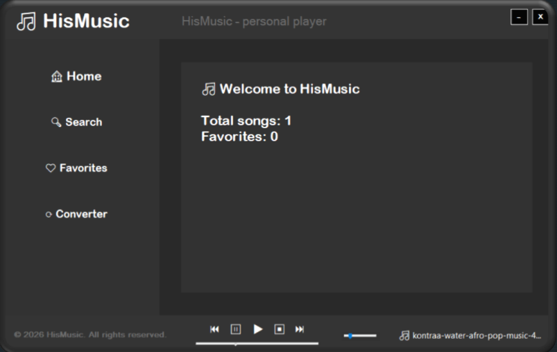
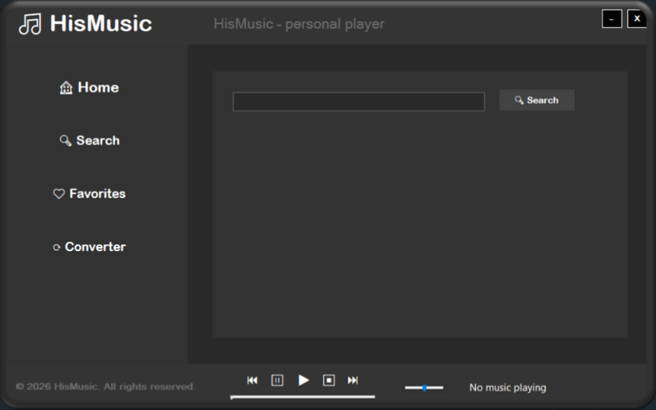
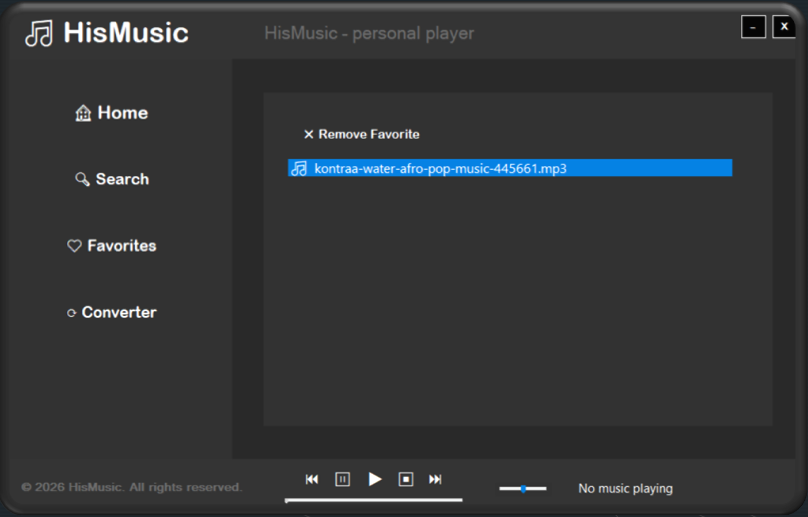
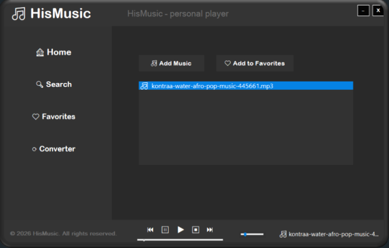

# HisMusic

C++ desktop music player with a modern dark theme interface.

## Features
- Music library management
- Music search
- Favorites management
- Audio converter

## Technologies
- C++/CLI
- .NET Framework 4.8
- Windows Forms
- Visual Studio 2022

## System Requirements
- Windows 10 / 11
- .NET Framework 4.8 or later
- 2 GB RAM
- 100 MB free disk space

## Installation & Usage
1. Download and extract the HisMusic archive.
2. Open the HisMusic folder.
3. Run `HisMusic.exe`.
4. Add audio files to your music library.

## Screenshots

### Music Player

### Search

### Favorites

### Audio Converter

